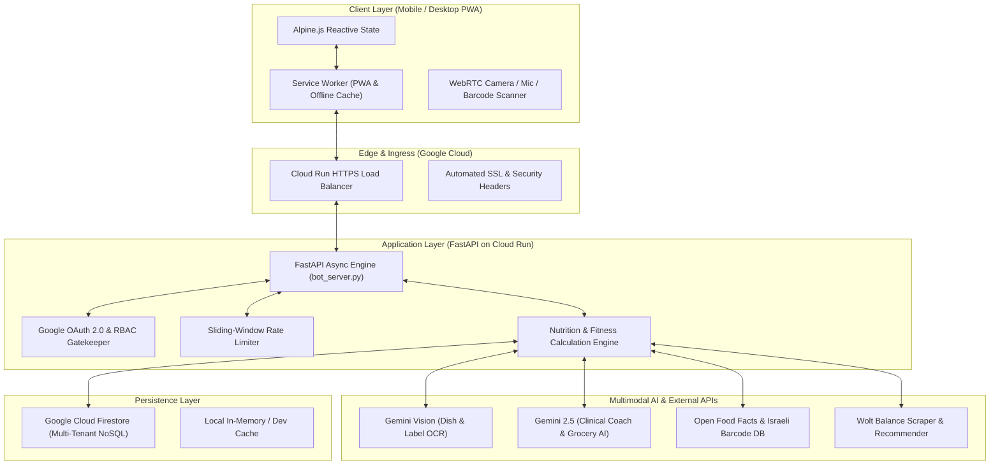
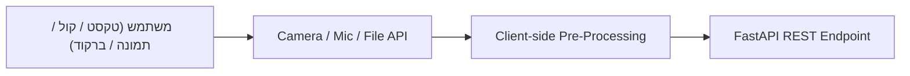
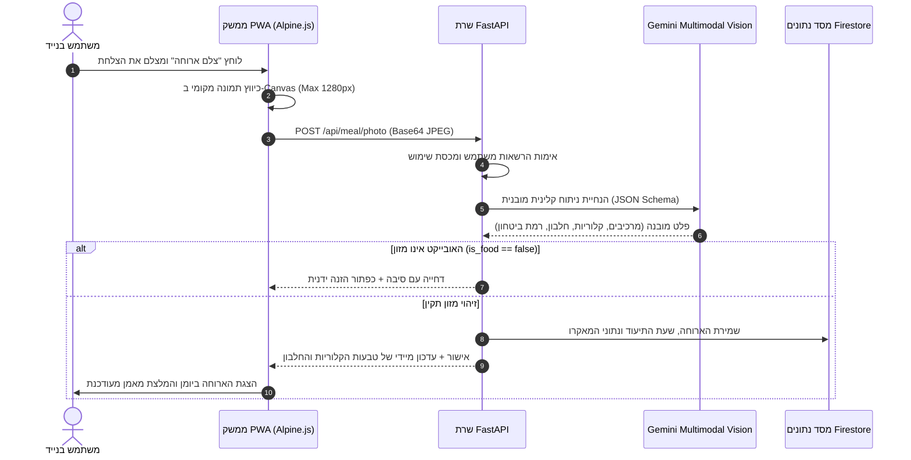
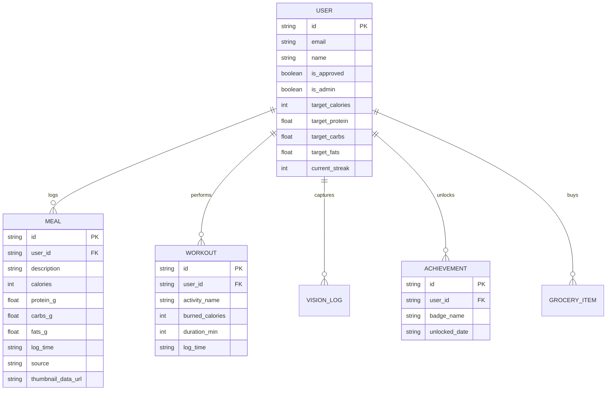

# NutriAgent AI — מפרט ארכיטקטורת מערכת (System Architecture)

> **גרסה פעילה:** v63 (Cloud Run Production)  
> **תאריך עדכון:** נובמבר 2026  
> **סביבת ענן:** Google Cloud Platform (`me-west1` Tel Aviv)

---

## 1. מבט-על ארכיטקטוני (System High-Level Architecture)

המערכת בנויה כ-Modern Micro-Services Architecture מונחית אירועים, המשלבת ממשק משתמש קצה מתקדם (PWA), שכבת API מאובטחת בענן ב-FastAPI, ומנוע בינה מלאכותית רב-מודאלי (Gemini AI Vision & NLP).

---

## 2. שכבות המערכת (Detailed Layer Breakdown)

### 2.1 שכבת הממשק (Frontend / Client Layer)
- **ארכיטקטורה:** Single-Page Progressive Web App (PWA) רספונסיבי, מותאם Mobile-First (iOS Safari & Android Chrome).
- **ניהול מצב (State Management):** ריאקטיביות קלת-משקל ומבוזרת באמצעות **Alpine.js** (`nutritionApp()`), ללא צורך ב-Node.js Build צד-לקוח, המאפשר טעינה מיידית (<0.5 שניות).
- **סגנון ומערכת עיצוב:** Tailwind CSS עם פלטת צבעים מותאמת (Clinical Duotone: Emerald, Indigo, Slate-900), וספריית סמלים וקטוריים ייעודית (SVG Sprite של 24 אייקונים דואוטוניים).
- **PWA & Offline:** `sw.js` מיישם אסטרטגיית **Network-First** לקבלת עדכונים חיים מיידיים, עם Offline Fallback מלא וסנכרון ברקע.
- **מנוע ריבוי שפות (i18n):** תמיכה מלאה ואינטגרלית בעברית (RTL) ובאנגלית (LTR) ברמת הממשק, כפתורים, תאריכים והודעות מאמן.

---

### 2.2 שכבת ה-API והשרת (Backend / Application Layer)
- **טכנולוגיה:** Python 3.12 עם **FastAPI** ו-Uvicorn (Asynchronous ASGI).
- **אבטחה והרשאות:**
  - **Google Identity Services (OAuth 2.0):** אימות טוקן JWT ישירות מול שרתי Google OAuth.
  - **שער אישור מנהל (RBAC Admin Gate):** משתמש חדש נוצר במצב `is_approved: false`. מנהל מערכת (`is_admin: true`) מאשר או חוסם משתמשים דרך דשבורד הניהול המאובטח.
  - **Rate Limiting:** הגבלת קצב דינמית למניעת ניצול יתר או מתקפות על מנועי ה-AI.
  - **CORS & Security Headers:** Content-Security-Policy קפדני, מניעת XSS, ומדיניות עוגיות מאובטחת.
- **חישובים מטאבוליים מבוססי מדע:**
  - אלגוריתם **Mifflin-St Jeor** לקביעת BMR ו-TDEE.
  - חלוקת מאקרו מותאמת אישית: יחס חלבון (1.6g–2.2g לק"ג משקל גוף), פחמימות ושומנים לפי יעד (חיטוב, מסה, שמירה).

---

### 2.3 מנוע הבינה המלאכותית (Multimodal AI Engine)

המערכת משתמשת במודלי ה-AI המתקדמים בעולם מבית Google DeepMind:

| מודול | מודל / מנוע | תפקיד במערכת |
| :--- | :--- | :--- |
| **זיהוי מנות וצילום צלחת** | `Gemini Vision` | פירוק הצלחת למרכיבים, הערכת משקלים קלינית, חישוב קלוריות, חלבון, פחמימות ושומן. |
| **סינון אובייקטים שאינם מזון** | Guardrail Detection | **דחייה על הסף** של פריטים שאינם מזון (למשל רהיטים, קמינים, מוצרי חשמל) עם אופציית עקיפה ידנית בלבד. |
| **סורק סופר ("האם לקנות?")** | Vision + OpenFoodFacts | ניתוח תמונת מוצר או תווית ערכים בסופר ומתן ציון התאמה (0-100) ליתרה הקלורית היומית. |
| **מאמן תזונה ואימונים AI** | `Gemini 2.5 Flash` | ניתוח בזמן אמת של חלון הצום, עמידה ביעד החלבון, והמלצה על ארוחה עתידית לסגירת היום. |
| **רשימת קניות חכמה לסופר** | Gemini Structured Output | סריקת החוסרים התזונתיים של השבוע והפקת רשימת קניות ממוינת לפי מחלקות סופר עם שיתוף לוואטסאפ. |
| **התאמת מנות מ-Wolt** | Wolt Semantic Fitting | סינון מנות ממסעדות באזור שמתאימות במדויק לחלון הקלורי שנותר בתקציב. |

---

## 3. תרשים זרימת נתונים: ניתוח ארוחה בצילום (Photo Logging Workflow)

---

## 4. מודל הנתונים (Core Data Entities)

המערכת פועלת בארכיטקטורת **Multi-Tenant** מופרדת לחלוטין:

---

## 5. תשתית הענן ו-DevOps (Infrastructure & Deployment)

המערכת פרוסה באופן מלא על גבי שירותי **Google Cloud Platform (GCP)** באזור `me-west1` (תל אביב):

- **Cloud Run (Serverless Container):**
  - קונטיינר מבוסס Dockerfile אופטימלי (Alpine / Slim Python).
  - Scale-to-Zero אוטומטי (חיסכון מרבי בעלויות) עם זינוק מיידי עד עשרות Instances במקרה של עומס.
  - זיכרון: 1GB RAM, 1 vCPU, תמיכה מלאה ב-Concurrency של 80 בקשות בו-זמנית לכל מופע.
- **Cloud Build & Git CI/CD:**
  - פריסה אוטומטית ישירות ממאגר ה-Git באמצעות `gcloud run deploy`.
  - Service URL חי עם SSL מלא: `https://nutrition-service-313955139672.me-west1.run.app`.
- **Google Cloud Secret Manager & IAM:**
  - ניהול מאובטח של מפתחות ה-API של Gemini ואישורי OAuth ללא שמירת סודות בקוד.
- **Cloud Monitoring & Logging:**
  - איסוף לוגים וצילומי Telemetry בזמן אמת לאיתור חריגות וזמני תגובה.

---

## 6. סיכום יתרונות הארכיטקטורה (Architectural Highlights)
1. **אפס תלויות שבירות:** ה-Frontend לא דורש Webpack/Vite מורכב — הקוד רץ ישירות מכל דפדפן במהירות שיא.
2. **הגנה מוחלטת מהזיות AI:** מנגנון Rejection Guardrail מונע מקרים שבהם חפצים ביתיים מוזנים בטעות כמזון.
3. **שמירה על פרטיות:** הפרדה קפדנית בין משתמשים (User ID Isolation) ללא חשיפת נתוני תזונה בין חשבונות.
4. **עומס קוגניטיבי מינימלי (Zen UX):** ארגון הכלים המתקדמים בטאבים ייעודיים, כפתורי שטח מגע אחידים וממשק מובייל מהיר.

